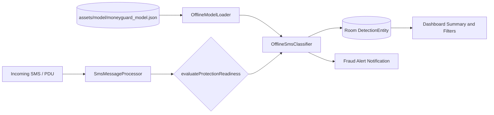

# MoneyGuard Malawi - System Architecture and Data Flow (v0.8)

## 1. High-Level Pipeline

1. Incoming SMS broadcast / PDU parts arrive at the receiver layer.
2. SmsMessageProcessor validates UDH headers, computes fingerprints (sender, body, timestamp, sequenceIndex, subscriptionId), and assembles multipart bodies.
3. Readiness gate (evaluateProtectionReadiness) verifies permissions, receiver configuration, and model availability.
4. OfflineModelLoader loads assets/model/moneyguard_model.json (478,956 bytes) into OfflineSmsClassifier with safe error details.
5. OfflineSmsClassifier scores normalized text and outputs classification, fraud/normal probabilities, and confidence.
6. Results map to DetectionEntity in Room for dashboard summary and filter views, and trigger fraudNotificationContent alerts when FRAUDULENT.

## 2. Mermaid Component Flow

